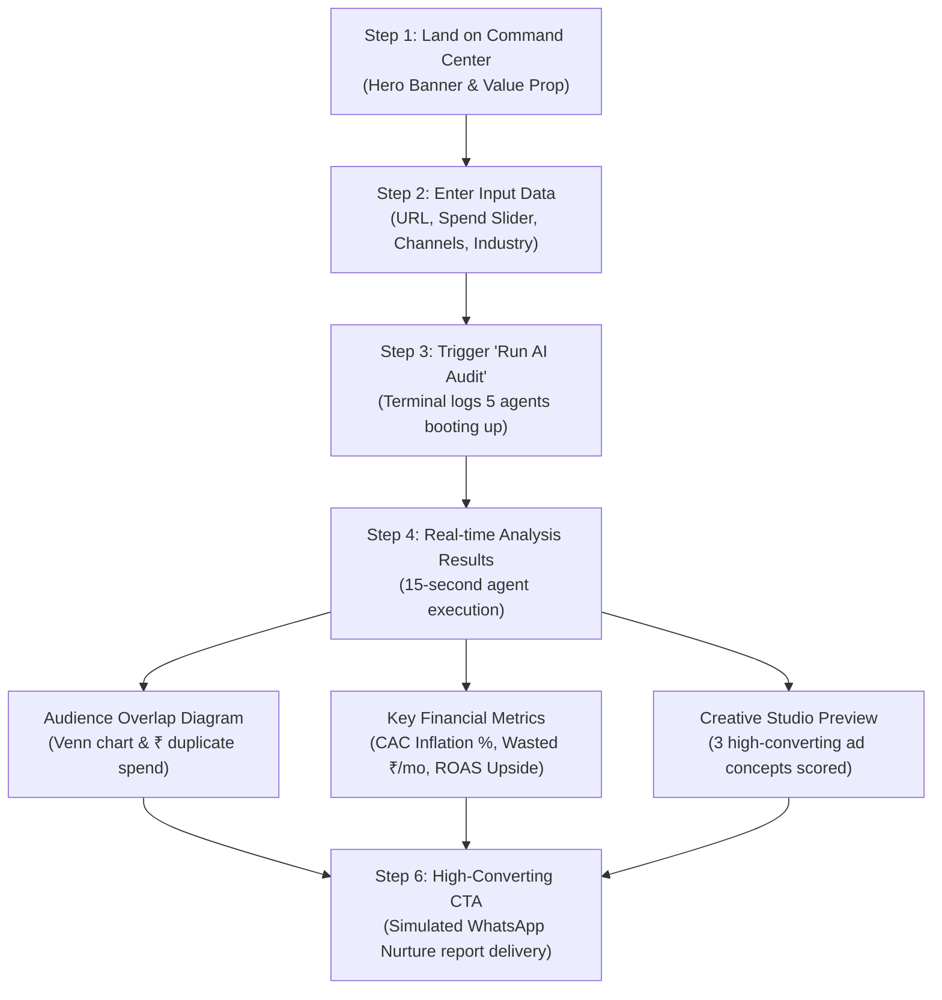

# 📜 Auroscale Pulse — MVP Specification & Rules
### *"An MVP, Not a Whole Company: Laser-Focused Proof-of-Work"*

---

## 🧭 The Core Philosophy

> **"Build an MVP, not a whole company."**  
> The goal of this project is **not** to build a complex SaaS platform with multi-tenant auth, stripe billing, or a massive database.  
> The goal is to build a **sharp, functional, visually stunning Product-Led Growth (PLG) prototype** in 24–48 hours that proves to **Kartikeya Neel Bakshi** that you understand Auroscale's product, think like an engineer, and write production-grade code.

---

## ⚡ 6 Cardinal Rules for This MVP

### Rule 1: Zero-Failure Demo Guarantee
* The application **must never fail** during a screen recording or live demo.
* Even if an external AI API has rate limits or network latency, the app **must feature an intelligent, deterministic fallback engine** that produces realistic, industry-accurate audit numbers, Venn calculations, and creative briefs.

### Rule 2: Strict Scope Boundaries (In vs. Out)

| IN SCOPE (Must Have) | OUT OF SCOPE (Do NOT Build) |
| :--- | :--- |
| ✅ Instant brand URL + spend input | ❌ User registration / Auth / Passwords |
| ✅ Interactive monthly spend slider (₹50k – ₹50L) | ❌ Database ORMs, Postgres, Prisma |
| ✅ Real-time multi-agent terminal scan (15s) | ❌ Stripe / Payment gateways / Invoicing |
| ✅ Audience Overlap Venn visualizer & ₹ leakage math | ❌ Real Meta/Google OAuth account sync |
| ✅ 3 multi-channel creative cards with predicted scores | ❌ Full-blown drag-and-drop video/image editor |
| ✅ WhatsApp lead capture simulator | ❌ Real Twilio / WhatsApp Business API keys |
| ✅ Auroscale dark-mode aesthetic (`#09090B`) | ❌ 10-page complex settings dashboard |

### Rule 3: Visual & Architectural Fidelity
* Must match Auroscale's visual identity:
  * Dark Canvas: `#09090B` (zinc-950)
  * Elevated Card Background: `#121215` / `#18181B`
  * Subtle borders: `#27272A`
  * Accent highlights: Neon purple (`#A855F7`), Electric blue (`#3B82F6`), Emerald (`#10B981`)
* Clean modern layout, monospace badges (`font-mono`), smooth animations.

### Rule 4: Clean, Production-Grade TypeScript
* Strict TypeScript without sloppy `any` types.
* Clear modular folder separation (`components/`, `lib/`, `app/`).
* Reusable domain logic in pure helper functions (`lib/audit-engine.ts`, `lib/creative-generator.ts`).

### Rule 5: Timebox Discipline
* Total coding time: **Under 1 day**.
* No getting stuck on minor perfectionism. If a component looks good and works smoothly, move directly to the next phase.

### Rule 6: Deliverable First
* The code is only 50% of the outcome. The other 50% is:
  1. A working live deployment on Vercel.
  2. A crisp 2-minute Loom video walking through the value prop.
  3. A direct, high-impact message to Kartikeya.

---

## 🔄 The End-to-End User Workflow

---

## 📋 Functional Requirements

### 1. Input Module
* **Brand Target:** Website URL or brand name (e.g. `cultsport.com`, `getacme.com`).
* **Spend Slider:** Dynamic range slider from ₹50,000 to ₹50,00,000 with a quick toggle for USD ($1,000 to $100,000).
* **Channel Selectors:** Multi-select chips for Meta, Google Ads, LinkedIn, and YouTube.
* **Industry Profile:** Dropdown or selector for D2C/E-commerce, B2B SaaS, Marketing Agency, and Local SMB.

### 2. Agent Execution Terminal
* Interactive console displaying simulated live telemetry:
  * `[Creative Studio Agent]` Analyzing brand positioning and hook fatigue...
  * `[Audience Intelligence Agent]` Mapping Meta Pixel vs Google Demand Gen overlap...
  * `[Campaign Optimization Agent]` Calculating marginal ROAS inflection point...
  * `[WhatsApp Nurture Agent]` Readying conversational nurture payload...
* Visual progress bar updating smoothly from 0% to 100%.

### 3. Overlap & Financial Leakage Engine
* Visual Venn/Euler diagram showing:
  * Meta Reach (e.g., 68,000 profiles)
  * Google Reach (e.g., 44,000 profiles)
  * Overlapping Cohort (e.g., 18,200 duplicate bids)
* Explicit calculation of:
  * **Wasted Monthly Spend:**
    $$\text{Wasted} = \text{Monthly Budget} \times \text{Overlap Ratio} \times \text{Cannibalization Factor}$$
  * **CAC Inflation Rate:** Percentage increase in customer acquisition cost caused by self-bidding.
  * **Projected Savings:** Exact amount saved with Auroscale's negative audience exclusion automation.

### 4. Creative Studio Ad Teardown
* Tabs for 3 formats:
  * **Instagram Story/Reel (Meta):** Visual concept prompt, high-converting hook, CTA button, predicted Virality Score.
  * **LinkedIn Feed Card (B2B):** Problem-first headline, value-focused copy, predicted Engagement Score.
  * **Google Search Ad:** 3 responsive headlines, 2 descriptions, predicted CTR Booster rating.

### 5. Lead Capture & WhatsApp Nurture
* Floating CTA button: *"Get Full 12-Page Audit & Negative Audience Exclusion List on WhatsApp"*.
* Modal prompt for phone number and name.
* Live WhatsApp chat simulator illustrating how Auroscale’s AI Agent qualifies leads and sends the audit autonomously.

---

## 🎯 Acceptance Criteria

The MVP is considered **Complete and Ready to Pitch** when:
1. `npm run build` runs with **zero TypeScript errors and zero lint warnings**.
2. The UI is 100% responsive across mobile and desktop.
3. Running an audit produces instantaneous, visually impressive metrics without crashing.
4. The project is deployed live on Vercel with a public URL.
5. The README clearly links the live demo, source code, and architectural overview.
